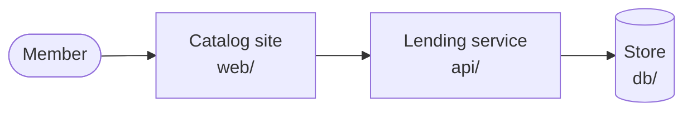

# Shelfshare — Architecture

Shelfshare runs a neighbourhood lending library. Members browse the catalog, borrow books and return them through a website; the library keeps every loan.

## Parts at a glance

| Part | Layer | Home |
| --- | --- | --- |
| Catalog site | presentation | `web/` |
| Lending service | application | `api/` |
| Store | database | `db/` |

Shelfshare calls no third-party system.

## Quality goals

- **Availability** — up while the library is open; members can wait for a restart outside those hours.
- **Expected scale** — one neighbourhood's members and books, so each part runs unreplicated.
- **Data retention** — every loan is kept for good, because the library is asked for lending history; see [Loans are closed, never deleted](../adr/0001-loans-are-closed-never-deleted.md).

## Sections

- [Blueprint](blueprint.md) — the parts and how they connect.
- [Data](data.md) — the stores, the entities and which part owns each.
- [Behavior](behavior.md) — the main flows across the parts.
- [Deployment](deployment.md) — what runs where, and why.

## Decision records

- [Loans are closed, never deleted](../adr/0001-loans-are-closed-never-deleted.md)
