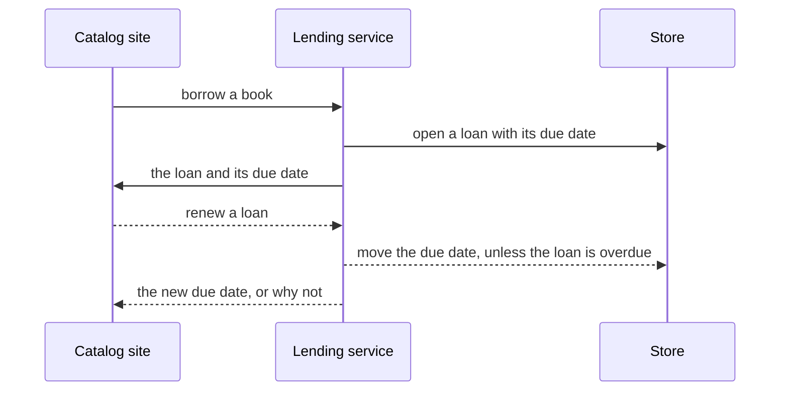
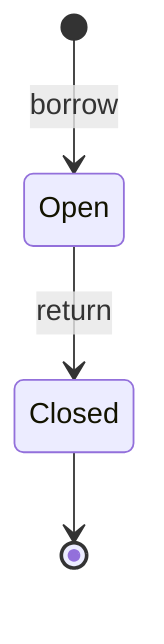

# Behavior

Two flows: a member borrows a book, and later returns it. A third, renewing a loan, is planned.

## Presentation

A member borrows from a book's page and returns from their loans page; the catalog site sends each request to the lending service and shows its answer.

From the loans page, a member renews an open loan, and sees the new due date or why it was refused. Planned: [Spec: Loan renewals](../spec.md)

## Application

Borrowing checks the book is on the shelf and opens a loan with a due date; returning closes the loan and puts the book back on the shelf.

Renewing moves an open loan's due date on, and is refused when the loan is overdue. Planned: [Spec: Loan renewals](../spec.md)

## Data access

Each flow reads and writes `catalog` and `loans` through the lending service's own queries, in one transaction, so a book is never both lent and on the shelf.

## Database

None — the store runs no triggers or jobs of its own; every rule is the lending service's.
