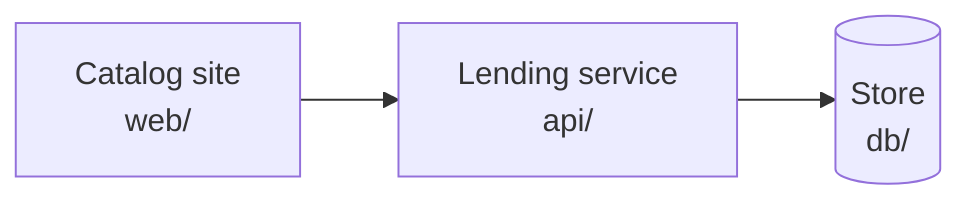
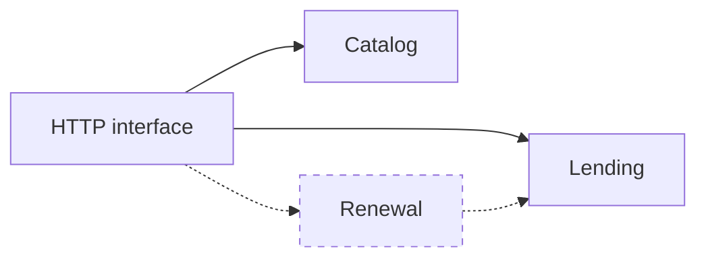

# Blueprint

The parts sit in a line: the catalog site talks only to the lending service, and only the lending service talks to the store.

## Presentation

The **catalog site**, home `web/`, renders the pages members browse, borrow and return from. It holds no rules of its own, so every decision about a loan is made in one place.

## Application

The **lending service**, home `api/`, holds the catalog and lending rules behind one HTTP interface: which books can be borrowed, by whom, and until when.

It also renews an open loan on its member's request, refusing a loan already overdue, so the rule sits beside the others that decide a loan. Planned: [Spec: Loan renewals](../spec.md)

## Data access

None — the lending service reaches the store through its own queries; no part stands between them.

## Database

The **store**, home `db/`, is a relational store holding the catalog and every loan, so a loan and its book are always read together.
