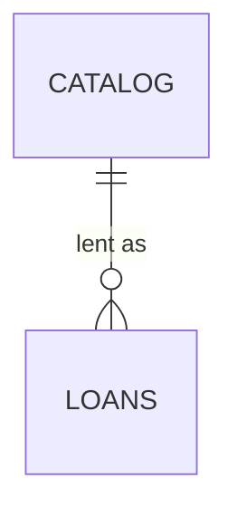

# Data

A relational store, owned by the lending service, holding the catalog and the loans as table groups.

## Presentation

None — the catalog site keeps nothing; each page reads through the lending service.

## Application

None — the lending service holds no cache; each request reads the store.

## Data access

The lending service, home `api/`, is the only part that reads or writes the store, through its own queries.

## Database

The **store**, home `db/`, owned by the lending service:

- `catalog` — the books the library holds and whether each is on the shelf.
- `loans` — every loan, open or closed, with its member and due date. A returned loan is closed, never deleted: see [Loans are closed, never deleted](../adr/0001-loans-are-closed-never-deleted.md).
