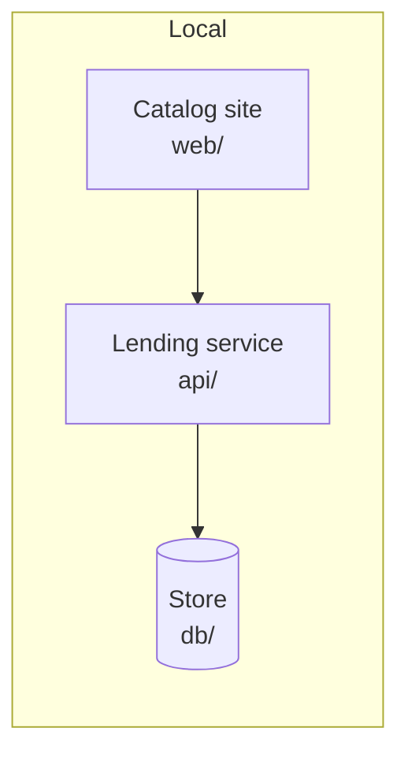

# Deployment

Local only: each part runs as a service of `compose.yaml` on the same machine, because a neighbourhood library needs no more.

## Presentation

The catalog site, home `web/`, runs as the `web` service, built from its home, in the local environment.

## Application

The lending service, home `api/`, runs as the `api` service, built from its home, in the local environment.

## Data access

None — no deployable stands between the lending service and the store.

## Database

The store, home `db/`, runs as the `db` service from a stock relational-store image in the local environment.
