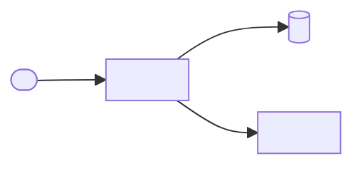

# <Project name> — Architecture

<What the project is and who it serves, in two or three sentences.>

## Parts at a glance

| Part | Layer | Home |
| --- | --- | --- |
| <Part> | <presentation, application, data access or database> | `<top-level directory, package or service>` |

## Quality goals

- **Availability** — <what is meant, and why>.
- **Expected scale** — <what is meant, and why>.
- **Data retention** — <what is meant, and why>.

## Sections

- [Blueprint](blueprint.md) — the parts and how they connect.
- [Data](data.md) — the stores, the entities and which part owns each.
- [Behavior](behavior.md) — the main flows across the parts.
- [Deployment](deployment.md) — what runs where, and why.

## Decision records

- [<Decision title>](<relative path to the record>)
