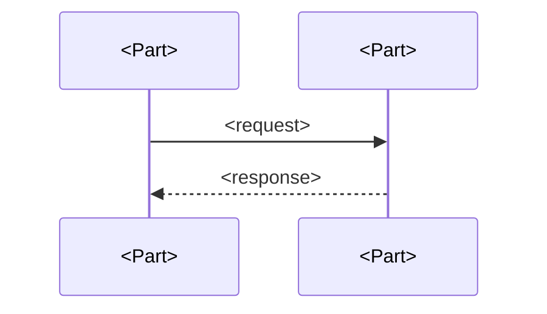
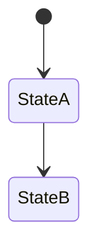

# Behavior

<The main flows across the parts.>

## Presentation

<The flows that start in this layer, step by step across the parts.>

## Application

<The flows this layer carries, and the rules that decide them.>

## Data access

<The reads and writes each flow makes, and through which part.>

## Database

<What the stores do on their own in a flow: triggers, scheduled jobs, constraints.>
