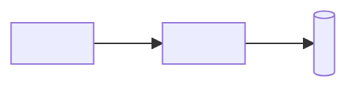
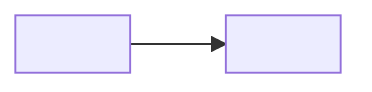

# Blueprint

<The parts and how they connect.>

## Presentation

<Each part in this layer: what it does, why it is shaped so, and its home.>

## Application

<Each part in this layer: what it does, why it is shaped so, and its home.>

## Data access

None — <reason this layer holds nothing>.

## Database

<Each part in this layer: what it does, why it is shaped so, and its home.>
