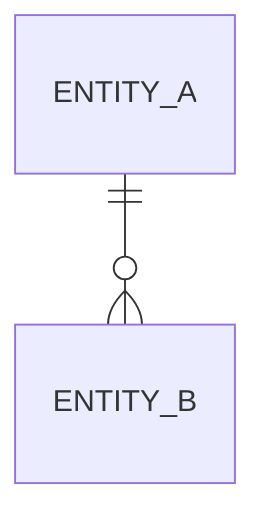

# Data

<The stores, the entities, and which part owns each.>

## Presentation

None — <reason this layer holds nothing>.

## Application

<The entities this layer holds in memory or caches, and which part owns each.>

## Data access

<How the parts reach the stores, and which part owns each access path.>

## Database

<Each store: what it holds, the part that owns it, and its home.>
