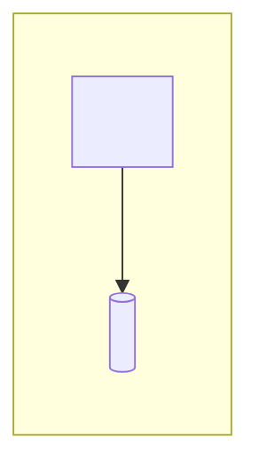

# Deployment

<What runs where, and why: each deployable, the environments, and how they connect.>

## Presentation

<Each deployable in this layer: where it runs, in which environments, and why.>

## Application

<Each deployable in this layer: where it runs, in which environments, and why.>

## Data access

None — <reason this layer holds nothing>.

## Database

<Each store: where it runs, in which environments, and why.>
